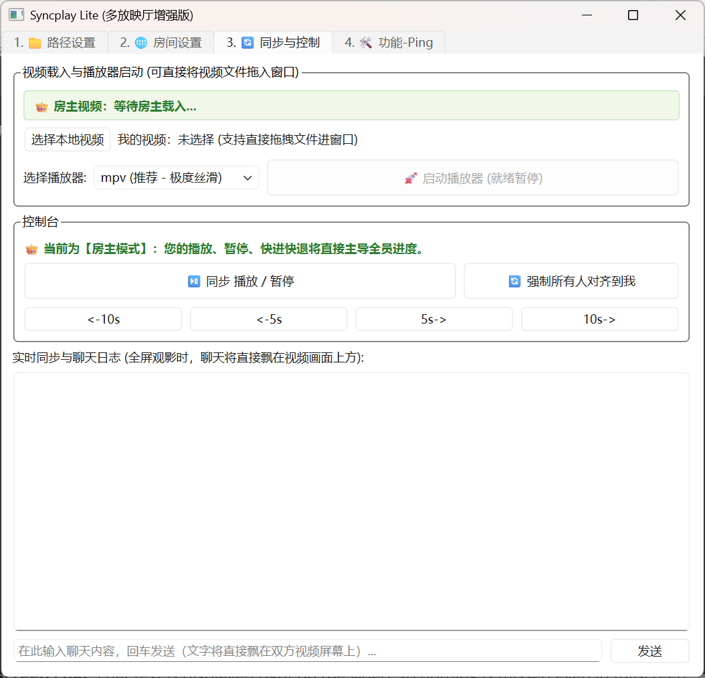

# Syncplay Lite

[English](README_EN.md) | **简体中文**

一个轻量的 Windows 局域网「一起看电影」同步工具。房主用自己的 mpv / VLC 播放本地视频，好友端自动跟随播放、暂停和快进快退，聊天文字会直接飘在视频画面上。

## 界面预览



## 特性

- **双播放器支持**：mpv（推荐，走 JSON-IPC，状态精准无延迟）/ VLC（备选，走 rc 接口）
- **实时进度同步**：房主每 2 秒广播一次时间基准，观众端偏差超过 2 秒自动对齐
- **视频内弹幕聊天**：聊天内容以 OSD 形式直接显示在视频画面上，全屏观影也不会错过
- **拖拽载入视频**：文件直接拖进窗口即可，不用打开播放器就能读出文件名、大小和时长
- **连通性诊断**：内置 ICMP Ping 与 TCP 端口探测，虚拟局域网连不上时可以先自检
- **配置自动记忆**：昵称、IP、播放器路径、上次选择的播放器都会保存
- **零额外服务端**：房主端本身即服务器，纯 PySide6 + 原生 socket

## 使用说明

程序分四个标签页，按顺序操作即可：

1. **路径设置**：选择 `mpv.exe`（推荐）或 `vlc.exe`，点「自动查找」通常能直接命中
2. **房间设置**：填写昵称 → 选择「做房主」或「加入好友」→ 填端口（默认 `8899`）→ 连接
3. **同步与控制**：选择视频 → 启动播放器（默认就绪暂停）→ 房主操作播放/暂停/快进，观众端自动跟随
4. **功能-Ping**：连不上时，用 ICMP 测网络是否通、用 TCP 探测 `8899` 端口是否可连

> 房主掌握播放权，观众端的控制按钮会被禁用，进度完全跟随房主。

## 联机方式（虚拟局域网）

本工具走的是普通 TCP 直连，只要双方处在同一个网络里就能用。不在同一局域网时，可以先借助虚拟局域网工具把两人「拉进同一个网络」，然后把房主界面里的 IP 填到好友端的「房主 IP」中即可。

常见选择：

| 工具 | 说明 |
| --- | --- |
| [Radmin VPN](https://www.radmin-vpn.com/) | 免费、安装即用，会分配一个 `26.x.x.x` 的虚拟 IP，配置最简单，**推荐** |
| [蒲公英](https://pgy.oray.com/) | 国内节点，连接稳定；免费版有设备数和带宽限制 |
| [网易 UU 加速器](https://uu.163.com/) | 主打游戏加速，也提供「联机」功能，适合已经装了 UU 的用户 |
| [Tailscale](https://tailscale.com/) | 基于 WireGuard，速度较好，需要账号登录 |
| [ZeroTier](https://www.zerotier.com/) | 同为组网工具，可自建节点，配置相对复杂一些 |

## 下载播放器

- mpv: https://github.com/zhongfly/mpv-winbuild/releases
- VLC: https://www.videolan.org/vlc/

## 运行

```bash
git clone https://github.com/byzh/byzh_LAN_Syncplay.git
cd byzh_LAN_Syncplay
pip install PySide6 python-vlc websockets
python main.py
```

## 打包

```bash
pyinstaller -F -w main.py
```

## 目录结构

| 文件 | 说明 |
| --- | --- |
| `main.py` | GUI 主界面与同步逻辑 |
| `network.py` | TCP/JSON 通信引擎、Ping 诊断 |
| `player_mpv.py` | mpv 命名管道 IPC 控制 |
| `player_vlc.py` | VLC rc 接口控制 |
| `media_utils.py` | 视频时长快速解析与格式化工具 |

## License

MIT
