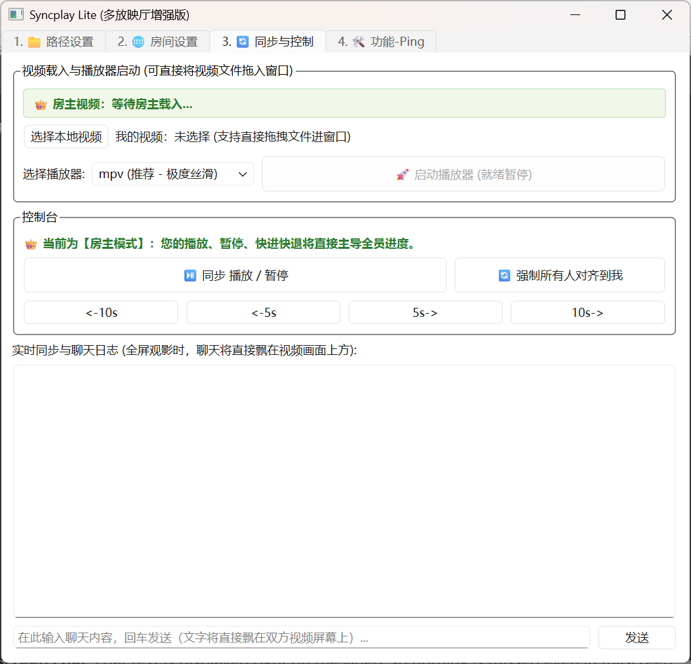

# byzh LAN Syncplay

<p align="center">
  
  
  
  
</p>

**English** | [简体中文](README.md)

A lightweight LAN watch-together tool for Windows. The host plays a local video with mpv or VLC, and viewers automatically follow play, pause and seek.

## Preview



## Usage

1. **Download `LAN-Syncplay.exe` from Releases**, or install Python and run the script
2. Paths: choose **`mpv.exe` (recommended)** or `vlc.exe` (not recommended)
3. Network: make sure both sides are on the same LAN (they must be able to ping each other)
4. Room settings:
   - Enter a nickname → choose "Host" → leave everything else unchanged → open the room
   - Enter a nickname → choose "Join" → enter the host IP → connect
5. **Sync & Control**: choose a video → launch the player → the host controls play/pause/seek, the viewer follows automatically

> The host holds playback control. Viewer-side control buttons are disabled and the progress always follows the host.

## Networking (Virtual LAN)

This tool uses a plain TCP connection, so it works as long as both sides are on the same network. If you are not on the same LAN, put both machines into one virtual network first, then enter the host's IP in the guest's "Host IP" field.

Common options:

| Tool | Notes |
| --- | --- |
| [Radmin LAN](https://www.radmin-lan.cn/) | Free and ready after install; assigns a `26.x.x.x` virtual IP. Easiest to set up -> **recommended** |
| [Oray Pugongying](https://pgy.oray.com/) | Chinese nodes, stable connections; the free tier limits devices and bandwidth -> **recommended** |
| [NetEase UU](https://uu.163.com/) | Game accelerator that also offers a co-op networking mode; handy if you already use it -> **recommended** |
| [Tailscale](https://tailscale.com/) | WireGuard based, good speed, requires signing in with an account |
| [ZeroTier](https://www.zerotier.com/) | Another mesh VPN, supports self-hosted nodes, a bit more setup |

## Download a player

- mpv:
  - Website: https://mpv.io/
  - Download: https://github.com/zhongfly/mpv-winbuild/releases
- VLC:
  - Website: https://www.videolan.org/vlc/
  - Download: https://www.videolan.org/vlc/download-windows.html

## Features

- **Two players supported**: mpv (recommended, JSON-IPC based, precise state with no polling delay) / VLC (fallback, via the rc interface)
- **Real-time progress sync**: the host broadcasts a time baseline every 2 seconds; the viewer re-seeks automatically once drift exceeds 2 seconds
- **On-screen chat**: chat text is displayed right on the video, so nothing is missed even in fullscreen
- **Drag & drop**: drop a video file into the window and its name, size and duration are read without launching the player
- **Network diagnostics**: built-in ICMP ping and TCP port probing for troubleshooting virtual LAN setups
- **Remembered settings**: nickname, IP, player paths and the last selected player are saved
- **No extra server**: the host machine is the server itself; just PySide6 plus plain sockets

## Install Python and run the script

```bash
# Clone the repository
git clone https://github.com/byzh/byzh_LAN_Syncplay.git
cd byzh_LAN_Syncplay

# Create a virtual environment
python -m venv .venv

# Install Python packages
.venv\Scripts\activate
pip install PySide6 pyinstaller -i https://pypi.tuna.tsinghua.edu.cn/simple

# Run
.venv\Scripts\activate
python main.py
```

## Scripts

| File | Description |
| --- | --- |
| `venv_main.bat` | Activate the environment and launch the app (the virtual environment must already exist) |
| `pyinstaller_build.bat` | Build the EXE (output goes to `dist/`) |
| `一键上传github.bat` | \ |

## Project layout

| File | Description |
| --- | --- |
| `main.py` | GUI and sync logic |
| `i18n.py` | Chinese/English UI string table + `tr()` translation helper |
| `network.py` | TCP/JSON messaging engine, ping diagnostics |
| `player_mpv.py` | mpv named-pipe IPC control |
| `player_vlc.py` | VLC rc interface control |
| `media_utils.py` | Fast video duration parsing and formatting helpers |

## License

MIT
